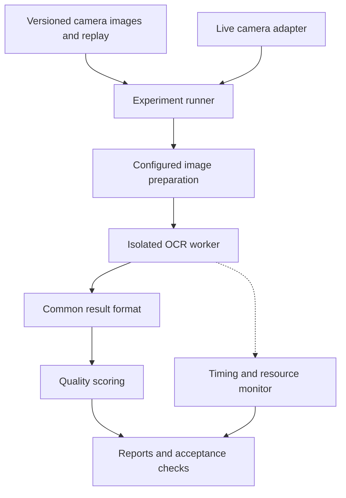

# Automotive infotainment OCR benchmark plan

**Status:** Updated draft incorporating Windows, both input modes, and multilingual requirements.
No implementation or benchmarks have run.

**Date:** 16 October 2026.

The input is camera-captured imagery of automotive infotainment screens.
Some images can be blurry.
The framework will compare OCR candidates for a production system.
Production OCR will execute on an external Windows test computer.
Saved images and live camera frames are both required.
Multiple languages and symbols are required; their exact sets remain open.

**Recommendation:** Compare complete pipelines, component quality, and deployment costs separately.
Use representative camera data and isolated Python workers.
Keep every unconfirmed requirement open.

## 1. Confirmed scope and open decisions

| Item | Status |
| --- | --- |
| Framework language | Python |
| Application | Automotive infotainment HMI OCR |
| Image source | Camera captures of infotainment screens |
| Image difficulty | Occasional blur is confirmed |
| Required candidates | PaddleOCR, RapidOCR, EasyOCR |
| Required comparison | Quality, performance, resources, FPS, CPU versus GPU |
| Additional candidates | Free or open-source engines |
| Current work | Planning and requirements gathering |
| Production execution location | External test computer, confirmed |
| Operating system | Windows, confirmed; version and architecture remain open |
| Python constraints | Unconfirmed |
| CPU, GPU, RAM, power limits | Unconfirmed |
| Input modes | Saved images and live camera frames, both confirmed |
| Language coverage | Multiple languages and symbols, confirmed |
| Exact languages, scripts, and symbols | Unconfirmed; distinguish text symbols from custom HMI icons |
| Required outputs | All visible text, text positions, expected-label verification, selected-region values, confirmed |
| Output text granularity | Unconfirmed |
| Camera resolution, frame rate, and capture setup | Unconfirmed |
| Existing images and annotations | Unconfirmed |
| Throughput, latency, and quality limits | Unconfirmed |
| Preprocessing, recapture, or multiple-frame processing | Unconfirmed |
| Unreadable-image handling | Explicitly undecided; compare candidate policies without selecting production behavior |
| Distribution and licence constraints | Unconfirmed |
| Command line, Python API, or graphical interface | Unconfirmed |

The following design implements those confirmed goals at the planning level.
Specific techniques and numeric acceptance limits remain proposals or open decisions.
No engine has been selected.

## 2. Candidate engines

Device support describes candidate execution routes, subject to target compatibility.
GPU does not imply NVIDIA hardware is available.
Exact versions, model files, and execution providers need recording before testing.

| Candidate | Proposed CPU route | Proposed GPU route | Role and boundary |
| --- | --- | --- | --- |
| PaddleOCR | PaddlePaddle CPU | PaddlePaddle GPU | Required full pipeline; compare suitable model sizes [S1] |
| RapidOCR | ONNX Runtime CPU; optional OpenVINO | Supported CUDA, TensorRT, or Paddle route | Required full pipeline; record provider and model ancestry [S2] |
| EasyOCR | PyTorch CPU | PyTorch GPU | Required full pipeline; pin detector, recognizer, and decoder [S3] |
| Tesseract | Native CPU engine through a Python adapter | Not planned for the baseline | Additional CPU baseline for full images and known regions [S4] |
| docTR | PyTorch CPU | PyTorch GPU | Additional detector and recognizer combinations [S5] |
| OpenOCR | PyTorch CPU or supported ONNX route | PyTorch GPU | Additional scene-text pipeline [S6] |
| MMOCR | PyTorch CPU, where supported | PyTorch GPU, where supported | Optional model research track; specify the actual model pair [S7] |
| TrOCR | PyTorch CPU | PyTorch GPU | Optional recognition-only track; requires cropped text lines [S8] |

Start with the three requested libraries and Tesseract.
Add docTR and OpenOCR after the measurement harness is validated.
Keep optional research candidates outside the initial implementation scope.

PaddleOCR currently documents PP-OCRv6 tiny, small, and medium variants [S1].
PP-OCRv5 mobile and server variants remain comparison candidates where useful.
Select models after confirming languages, hardware, and resource constraints.

RapidOCR supports models converted from PaddleOCR [S2].
A RapidOCR result may therefore compare deployment backends rather than independent models.
Do not interpret library names as independent model architectures.

Record code licences, weight licences, and required notices separately.
Open-source code alone does not establish every model's distribution terms.
The initial production shortlist requires confirmed compatibility with intended use.

## 3. Questions the benchmark must answer

1. Which configurations detect and read the required HMI text correctly?
2. How does quality change across realistic camera conditions?
3. Which configurations satisfy latency and resource limits on target hardware?
4. What additional cost or benefit comes from GPU execution?
5. Which failures can be detected and rejected reliably?
6. Does image preparation improve correctness enough to justify its cost?
7. Can live results stay current under sustained load on the Windows test computer?

## 4. Architecture

**One adapter per engine.**
The runner should not import every OCR framework into one Python process.
Use separate environments and workers to control dependencies and resource ownership.

Keep workers alive during warm inference measurements.
Use fresh workers for initialization and first-result measurements.
Run performance candidates sequentially on a shared device.

| Proposed component | Responsibility |
| --- | --- |
| Configuration validator | Reject missing required settings and unsupported combinations |
| Dataset loader | Load immutable images, labels, groups, and capture metadata |
| Live source adapter | Capture frames, preserve timing, and record acquisition faults |
| Replay source | Deliver a recorded session with preserved arrival intervals |
| Preparation pipeline | Apply explicit transformations and retain coordinate mappings |
| Engine adapter | Load models, expose capabilities, predict, synchronize, and close |
| Worker manager | Isolate dependencies, enforce timeouts, and record failures |
| Runner | Schedule trials, warmups, repetitions, and controlled experiment order |
| Evaluator | Match regions and compute component and application metrics |
| Telemetry monitor | Measure CPU, memory, GPU, and optional power telemetry |
| Reporter | Produce comparisons, evidence, distributions, and gate results |

The adapter contract should expose initialization and teardown.
Prediction returns source-image polygons, text, confidence values, and status.
Stage timing and batch support are declared capabilities, not universal guarantees.

### Required application operations

**All four operations are required.**
Share one full-image OCR result across operations where it provides sufficient information.
Measure operation-specific logic and total application latency separately.

| Operation | Proposed input | Proposed output | Principal quality check |
| --- | --- | --- | --- |
| Read all text | Camera image and any configured screen scope | Text regions with original strings | Complete-pipeline text precision, recall, F1, and strict text agreement |
| Return text positions | Camera image | Polygons in source-image coordinates | Polygon matching and localization quality |
| Verify expected labels | OCR result, expected labels, and optional search regions | Match result with evidence and location | False passes, false failures, uncertain results, and successful coverage |
| Read selected-region values | OCR result or measured region inference, region definitions, and field rules | Original text; parsed value/unit when applicable | Exact field correctness, extraction coverage, and parser errors |

The exact API names and schemas remain implementation proposals.
Screen scope, word/line granularity, and region-definition method remain open.
Text outside the intended HMI area needs an explicit annotation policy.

Expected labels should be evaluated against recognized text in the baseline.
Do not silently supply expected answers to the recognizer.
An application vocabulary can be tested as a separately declared configuration.

Region extraction can reuse the full-image OCR output.
Native region-only inference becomes a separate performance track when supported.
Do not count reused inference as four separate full-image OCR calls.

Compare region-only inference with known-crop recognition and full-image extraction separately.
This reveals the effect of cropping, scale, and detector behavior.
Include region preparation and coordinate mapping in application timing.

Verification should retain the candidate text, polygon, and matching rule.
Keep uncertain results distinct from incorrect matches and engine failures.
The final production treatment of uncertainty remains undecided.

For values, preserve raw strings alongside parsed outputs.
Classify transcription, region-selection, and parsing failures separately.
Do not hide incorrect digits through fuzzy numeric matching.

### Common result contract

| Record | Required contents |
| --- | --- |
| Experiment identity | Run ID, configuration hash, repetition, and benchmark code revision |
| Input identity | Sample ID, source capture group, image hash, and dimensions |
| Engine identity | Library version, model identifiers, hashes, and language settings |
| Execution identity | Runtime, requested device, observed device, precision, and thread settings |
| Region prediction | Source-image polygon, original text, scores, and granularity |
| Timing | Named boundaries, durations, initialization, and synchronization policy |
| Outcome | Success, timeout, crash, invalid output, or explicit abstention |
| Evidence | Raw engine output, logs, and optional overlay references |

Use null for unavailable confidence or stage timing.
Never invent a confidence score for an engine that lacks one.
Keep detection and recognition confidences distinct when available.

### Windows execution profile

**Recommend native Windows workers as the initial compatibility baseline.**
Use explicit interpreter paths for each isolated engine environment.
Any WSL or container experiment must have a separately identified execution profile.

Confirm Windows version, CPU architecture, Python compatibility, and driver versions first.
Create separate CPU and GPU environment locks where dependency combinations require them.
Do not assume every candidate backend supports the same Windows/Python combination.

Preflight checks should initialize each model and execute a representative image.
Validate actual device use, language configuration, output format, and worker shutdown.
Record missing dependencies or unsupported combinations before starting benchmark runs.

PaddlePaddle publishes Windows installation guidance [S9].
ONNX Runtime documents CUDA, cuDNN, and Windows DLL requirements [S10].
Select exact versions only after confirming the test computer's GPU and constraints.

Keep GPU compatibility failures distinct from OCR accuracy failures.
Collect supported CPU, memory, and GPU telemetry on the actual Windows host.
Record Windows power settings and representative competing workloads for each profile.

### Input source contract

| Frame property | Purpose |
| --- | --- |
| Source and session identity | Associate saved, replayed, and live inputs |
| Frame identity | Trace each capture, prediction, and dropped frame |
| Image representation | Declare dimensions, pixel format, orientation, and transformations |
| Camera timestamp, when available | Identify sensor timing and its clock source |
| Host receive timestamp | Measure latency from application receipt |
| Replay schedule, when applicable | Preserve original arrival intervals |
| Capture status | Record acquisition failures without confusing them with OCR failures |

Timestamp origins and clock mappings must be explicit.
Host receipt time is not automatically camera exposure time.
Without reliable sensor timestamps, label latency as host-receipt-to-result.

## 5. Dataset and annotation plan

**Real camera images form the main evaluation set.**
Synthetic perturbations supplement real captures in a separately reported stress set.
Dataset size follows scene diversity and statistical precision needs.

### Camera and screen coverage

| Dimension | Proposed coverage |
| --- | --- |
| Blur | Defocus and motion blur, tagged separately |
| Exposure | Bright, dim, overexposed, and clipped regions |
| Reflections | Glare, specular highlights, and partial reflections |
| Geometry | Viewing angles, perspective, distance, and lens distortion |
| Display artifacts | Moiré, refresh bands, rolling-shutter effects, and flicker |
| HMI content | Menus, navigation, media, settings, dialogs, and changing values |
| Text appearance | Small text, thin fonts, low contrast, and disabled states |
| Themes | Required day/night themes and background combinations |
| Language | Required scripts, mixed text, punctuation, and units; exact coverage pending |
| Negative examples | Blank screens, icons, graphics, reflections, and absent target text |
| Capture faults | Partial screens, occlusion, corrupted frames, and missing frames |

These are proposed coverage dimensions, not claims about the user's current camera.
Prioritize conditions observed in actual captures.
Record text height in pixels alongside overall image resolution.

Store camera settings where available.
Include exposure, focus mode, resolution, gain, distance, and angle.
Use capture-session identifiers even when detailed camera telemetry is unavailable.

### Ground truth

Annotate polygons, exact text, language, readability, and scene identity.
Agree word versus line granularity before annotation.
If both are needed, preserve their explicit hierarchy.

For HMI assertions, also annotate expected text, target region, and expected presence.
Include repeated labels and deliberately incorrect or absent targets.
Correct text in the wrong region must not pass an assertion.

Distinguish intended UI text from what the camera visibly captured.
Use authoritative UI state information when available, without feeding it into OCR.
Mark human-unreadable regions explicitly through a documented review policy.

Readable difficult text stays inside the standard accuracy denominator.
Human-unreadable regions receive separate availability and abstention evaluation.
Do not label an unreadable image correct because OCR guessed intended text.

Use reviewed annotations for evaluation.
OCR-assisted labels require human correction before becoming ground truth.

### Dataset separation

Maintain development, validation, and untouched test partitions.
Use development data for engineering and validation data for configuration selection.
Use the test set only after configurations are frozen.

Group related frames, crops, and augmentations into the same partition.
Keep capture sessions and near-duplicate content from leaking across partitions.
If generalization to unseen HMI versions matters, reserve them explicitly.

Treat supplied expected-label lists as application context.
Compare with and without that context when relevant.
Do not give hidden test transcripts to preprocessing or recognition.

### Multilingual and symbol coverage

**Define coverage for each model configuration, not merely each library.**
The required languages and symbol inventory still need explicit examples.
Do not interpret the requirement as automatic support for every Unicode character.

| Coverage item | Proposed evaluation |
| --- | --- |
| Individual languages | Separate exact-match, detection, and transcription metrics |
| Mixed-language regions | Correctness within the same line, screen, or selected region |
| Diacritics and combining marks | Strict text and grapheme-aware diagnostic errors |
| Text symbols | Exact symbol identity and symbol-specific confusion counts |
| Digits and locale conventions | Exact values, decimal separators, signs, and units |
| Reading direction | Declared logical text order and spatial output expectations |
| Unsupported glyphs or scripts | Explicit capability gaps and required-coverage failures |
| Custom icons or private glyphs | Separate annotation category pending scope confirmation |

Text symbols include punctuation, units, currency, and mathematical characters where required.
Custom graphical HMI icons may require a separate visual recognition task.
Do not add icon recognition to implementation scope without confirming this distinction.

EasyOCR documents restrictions on simultaneous language combinations [S3].
Other candidates also require a configuration-specific language and dictionary check.
Include model loading, routing, and extra recognizers in timing and memory costs.

Compare known-language and unknown-language operation separately if both are needed.
Use an externally available HMI locale only when the application provides it.
Do not derive production routing inputs from hidden test annotations.

Keep original Unicode strings intact in annotations and results.
Version any normalized scoring policy and report its effect separately.
Avoid dropping accents, signs, or symbols to inflate apparent accuracy.

Unicode defines grapheme clusters and text segmentation boundaries [S11].
Add grapheme-aware error analysis alongside a clearly defined character-error calculation.
Use language-appropriate word segmentation rather than universal whitespace splitting.

Report quality per language, script, and required symbol group.
Also report macro averages and any explicitly agreed deployment-weighted aggregate.
A large easy-language subset must not hide another required language's failure.

Present both shared-supported-subset comparisons and complete required-coverage results.
Keep unsupported required scripts visible in eligibility and coverage tables.
Never silently remove unsupported languages to improve a candidate's ranking.

## 6. Quality metrics

**Report detection, recognition, and complete-pipeline quality independently.**
Recognition on ground-truth crops isolates recognition errors from detector misses.
Recognition-only engines cannot enter full-pipeline rankings without a named detector.

| Metric group | Measurement | Interpretation |
| --- | --- | --- |
| Detection | Polygon precision, recall, and F1 | Finds required text and avoids false regions |
| Localization | Matched polygon overlap and misses by text size | Shows geometric quality and small-text weaknesses |
| Recognition | Character error rate, word error rate, exact word/line match | Measures transcription using known crops |
| Complete OCR | Region-level precision, recall, and F1 requiring correct text | Measures joint localization and transcription |
| Required fields | Exact text and unit match in the correct region | Measures application-relevant values |
| Screen outcome | Fraction of screens with every required field correct | Prevents averages hiding incomplete results |
| Negative inputs | False text regions per image and false-positive image fraction | Measures text invented on icons or blank regions |
| Required label verification | False-pass and false-fail rates | Measures incorrect automated test decisions |
| Confidence | Error versus retained coverage; optional calibration metrics | Shows whether rejection improves accepted results |
| Camera robustness | Metrics by blur, glare, angle, and text size | Identifies operating limits |

Character error rate is total character edit distance divided by reference characters.
Word error rate uses the corresponding word counts and tokenization policy.
Both can exceed 100 percent because insertions count as errors.

Define empty-reference behavior explicitly.
Use negative-input metrics rather than silently dividing by zero.
Report aggregate counts and per-group results together.

Use thresholded, one-to-one polygon matching with a declared overlap threshold.
Freeze matching, grouping, and ignored-region rules before final evaluation.
Do not change region-merging rules to favor a particular engine.

Preserve original case, punctuation, spacing, and Unicode in raw outputs.
Report strict results alongside any approved normalized results.
Normalization must not hide wrong digits, decimal points, signs, or units.

For example, a wrong decimal point can invalidate a displayed numeric value.
Therefore, broad character accuracy cannot replace field-level exact matching.
Required fields and their importance remain unconfirmed.

Confidence scales differ between engines.
Choose engine-specific thresholds using validation data.
Compare retained coverage and residual errors at declared operating points.

Abstentions, failures, and rejected inputs remain visible in all application denominators.
A configuration must not appear accurate simply by refusing difficult inputs.
Show both correctness among accepted outputs and total successful coverage.

### Verification test cases

Include positive queries with a clearly visible expected label.
Include negative queries where the expected label is absent or different.
Negative queries must reflect plausible application mistakes and HMI states.

Include duplicate labels appearing in different screen regions.
Include similar strings and numeric differences that change the displayed meaning.
Text outside a requested region must not satisfy that region's query.

False-pass rate uses genuinely negative queries as its denominator.
False-fail rate uses genuinely positive queries as its denominator.
Report uncertain outcomes separately for both populations.

Also report the fraction of queries resolved correctly across all submitted queries.
This prevents a high rejection rate from producing a misleadingly low error rate.
Final acceptance depends on both correctness and successful coverage.

## 7. Timing, throughput, and resource metrics

### Timing boundaries

| Boundary | Included work |
| --- | --- |
| Initialization | Worker/model loading and device initialization, defined separately |
| First result | Initialization plus the first completed request |
| Warm OCR call | Adapter preparation, device transfers, OCR, and returned result conversion |
| Image-to-result pipeline | Decoding, optional preparation, worker transfer, and completed OCR result |
| Application operation | OCR result plus label matching or value extraction, as applicable |
| Live capture-to-result | Capture delivery, queueing, processing, and publication; timestamp origin declared |

Report median, p90, p95, and p99 latency with sample counts.
Keep cold-start and warm measurements separate.
Name cache state, warmup policy, and model-cache availability.

Download model files before inference timing.
Measure installation or provisioning time separately if operationally relevant.
Do not include an accidental network download in ordinary inference latency.

Synchronize accelerator work at relevant timing boundaries.
Include required host-to-device and device-to-host work in completed-call timing.
Treat native kernel timings as diagnostic measurements with different boundaries.

**FPS means completed original frames divided by elapsed wall time.**
Report recognition crops per second separately.
Do not count crops as full frames or derive streaming FPS from median latency.

For each throughput measurement, state batch size, worker count, and input mix.
Use a single-request latency baseline as a proposed comparison track.
Test batching separately when the application permits its additional waiting time.

### Resource measurements

| Resource | Proposed measurements |
| --- | --- |
| CPU | CPU time, core-seconds per frame, and utilization with a stated convention |
| Host memory | Idle, steady, and observed peak memory; process-tree scope recorded |
| GPU | Observed device, utilization, and available per-process memory telemetry |
| GPU memory | Baseline, steady, and peak VRAM; allocated/reserved distinctions where exposed |
| Footprint | Model bytes, environment size, and optional exported-engine size |
| Stability | Memory growth, latency drift, and error rate over sustained runs |
| Optional power | Supported sensor measurements and approximate energy per completed frame |

CPU utilization can exceed 100 percent under per-core reporting.
Always record thread counts, allocated cores, and measurement convention.
Avoid comparing CPU percentages without this context.

Memory samplers can miss brief peaks.
Record sample cadence and use native high-water measurements where available.
Document shared-memory double counting in any summed process RSS figures.

GPU utilization may describe the whole device, not one OCR worker.
Measure on an otherwise controlled device and retain telemetry provenance.
Unsupported telemetry remains unavailable, rather than zero.

Power comparisons require compatible sensors and a declared baseline.
Separate measured energy from estimates.
Do not infer embedded power consumption from workstation measurements.

### CPU versus GPU comparisons

Compare the same model family, weights, inputs, and precision where supported.
Use FP32 as one possible controlled track, subject to compatibility.
Report FP16 or quantized optimization as separate configurations.

For converted models, retain source hashes and converted artifact hashes.
Check conversion quality differences instead of assuming numerical equivalence.
Include host CPU and memory costs in GPU reports.

The external test computer is the production execution target.
Capture software and test automation may share its resources; this remains unconfirmed.
Propose separate controlled and representative shared-load profiles if they do.

Verify the requested execution provider through runtime evidence.
An unnoticed CPU fallback invalidates a GPU-labelled run.
Explicitly supported mixed-device pipelines need their own names and measurements.

## 8. Blur handling and image preparation

**Measure rejection and recovery alongside recognition.**
OCR should expose uncertainty when visible information cannot support a reliable answer.
The acceptable response to unreadable captures requires a product decision.
The user has explicitly left this decision open.

### Policies to compare before choosing behavior

| Policy | Benchmark behavior | Dependency |
| --- | --- | --- |
| Single-image baseline | Return predictions and retain all errors for scoring | Individual camera images |
| Uncertainty reporting | Return an uncertain result under a calibrated quality/confidence gate | Validation data and declared thresholds |
| Recapture | Request another capture within a recorded budget | Capture control and an agreed waiting budget |
| Multiple-frame processing | Select or combine permitted frames within a time window | Ordered frames and an agreed waiting budget |

Only compare policies supported by the available input data.
Single saved images cannot establish real recapture performance.
Use actual later captures when measuring retry success and waiting time.

For each supported policy, report accepted correctness, coverage, latency, and extra work.
Report incorrect confident outputs on unreadable regions separately.
Do not assign a production default until the behavior is agreed.

| Proposed profile | Purpose |
| --- | --- |
| Raw camera image | Establish the unmodified application baseline |
| Screen rectification | Test screen localization, perspective correction, and cropping |
| Controlled resize | Test small-text visibility and inference cost |
| Contrast or denoise | Test measurable improvements under observed capture conditions |
| Sharpening or deblur | Experimental profile; check altered digits and false text carefully |
| Quality gate | Reject or flag captures using validation-calibrated quality signals |
| Multiple-frame selection | Conditional profile if additional frames and waiting are allowed |

Keep preparation profiles explicit and versioned.
Include their costs in image-to-result timing.
Map predicted regions back into original camera coordinates.

Use real defocus and motion-blur examples for the main robustness results.
Supplement them with versioned synthetic kernels and declared severity settings.
Never claim synthetic blur levels directly represent real camera conditions.

Sharpness measures can help stratify captures.
A universal threshold cannot be assumed across resolutions and scenes.
Calibrate quality gates on representative validation data.

If learned deblurring is considered, evaluate it as another model dependency.
Measure incorrect confident outputs, latency, memory, and licence requirements.
Preserve an auditable route from source image to final text.

## 9. Saved-image, replay, and live-camera evaluation

**Both saved images and live camera frames are confirmed requirements.**
Use the same frame/result contract and OCR adapters across input modes.
Separate reproducible engine comparison from live acquisition behavior.

| Track | Primary purpose | Measurement boundary |
| --- | --- | --- |
| Saved images | Reproducible quality and single-request timing | Image load or decoded image to completed result, explicitly named |
| Timed replay | Comparable throughput, queueing, and overload behavior | Recorded arrival schedule to completed result |
| Live camera | Windows capture integration and current-result behavior | Sensor or host-receipt timestamp to published result |

Record representative sessions for sequential replay through every candidate.
Preserve frame identity, original image quality, and arrival intervals.
Use identical recorded frames when making paired engine-quality comparisons.

Live sessions may contain different content across candidate runs.
Do not attribute those differences solely to engine quality.
Live quality measurements need synchronized ground truth for their evaluated frames.

Frames without verified labels can still support timing and resource measurements.
They cannot establish complete text-recognition accuracy.
Known-label assertions provide narrower evidence than full-image text annotations.

### Camera adapter and queue policy

The camera model and connection method remain unconfirmed.
Propose OpenCV for compatible camera interfaces or a vendor adapter where necessary.
OpenCV documents Windows capture backends and vendor-driver limitations [S12].

Record the actual backend and negotiated resolution, format, and frame rate.
Check which focus and exposure controls the chosen device actually supports.
Do not assume requested camera settings were applied.

Use bounded queues with explicitly configured behavior.
Compare queueing every frame against dropping stale frames when both are useful.
Do not choose a production dropping policy before task deadlines are agreed.

Measure acquisition, queueing, image preparation, OCR, and application logic separately.
Preserve input and output timestamps for every frame.
Separate camera drops, deliberate queue drops, and inference failures.

### Live and replay protocol

1. Replay timestamped capture sequences at declared arrival rates.
2. Record received, processed, dropped, rejected, and timed-out frames.
3. Measure queue depth, capture age, and capture-to-result latency.
4. Evaluate correct results delivered before the required deadline.
5. Test overload behavior using a declared queue and frame-dropping policy.
6. Measure output stability only while the underlying UI text remains unchanged.
7. Measure response time separately when the displayed text changes.

Stable but incorrect repeated text must not receive a stability reward.
Avoid using later frames to improve earlier real-time decisions.
Count every frame used by multi-frame processing and report its waiting cost.

## 10. Experiment design and fairness

Avoid an unrestricted cross-product of all settings.
Use staged experiments with preserved configurations and raw measurements.

| Stage | Comparisons | Output |
| --- | --- | --- |
| Reference configurations | Documented usable configurations on the same data | Initial quality and compatibility results |
| Controlled backend comparison | Shared models across CPU, GPU, and eligible runtimes | Deployment overhead and acceleration evidence |
| Camera robustness | Candidate configurations across capture-condition strata | Quality degradation and operating limits |
| Validation tuning | Comparable declared tuning budgets | Frozen candidate settings |
| Optimized deployment | Supported precision, threads, batching, and preparation | Quality, latency, and resource tradeoffs |
| Final evaluation | Frozen configurations on untouched test data | Defensible shortlist and acceptance results |
| Sustained operation | Selected configurations under representative duration/load | Stability and operational evidence |

Record detector/recognizer versions, language dictionaries, thresholds, and resize rules.
Record every transformation and any application lexicon.
Different model families remain separate experiments, even under one library.

Control CPU thread pools and record environment settings.
Keep power mode, accelerator state, and competing load consistent.
Repeat trials and rotate candidate order to reduce thermal-order effects.

Use warmups defined before the run.
Record seeds and deterministic options where supported.
Measure observed variation rather than promising bitwise GPU determinism.

Use paired comparisons on the same captures.
Estimate uncertainty using capture sessions or scenes as independent groups.
Repeated inference of one image does not increase dataset diversity.

Report confidence intervals for quality differences where sample support permits.
Include sample counts and uncertainty when reporting tail latency.
Do not treat adjacent video frames as independent quality observations.

Keep errors, timeouts, crashes, and invalid outputs in the report.
Apply their declared application-level failure treatment.
Unsupported configurations are marked unsupported, not benchmarked as zero-speed engines.

## 11. Reliability and framework validation

The harness must be validated before using its rankings.
These are proposed future tests, not work already performed.

| Test family | Required evidence |
| --- | --- |
| Metric correctness | Perfect text, substitutions, omissions, insertions, and empty references score correctly |
| Matching correctness | Wrong positions, duplicates, ignored regions, and split/merged predictions behave as specified |
| Coordinate correctness | Cropping and rectification return valid source-image polygons |
| Execution correctness | CPU fallback cannot produce a valid GPU-labelled result |
| Failure accounting | Timeout, crash, and malformed results cannot disappear from denominators |
| Reproducibility | A stored configuration and dataset recreate comparable results |
| Isolation | Worker shutdown releases resources and restarts remain measurable |
| Stability | Sustained operation exposes leaks, deadlocks, and latency drift |
| Required streaming | Frame IDs, timestamp origins, drops, and stale results stay traceable |
| Multilingual scoring | Unicode, combining marks, reading order, and script-aware tokenization stay consistent |
| Required coverage | Unsupported languages and symbols cannot disappear from candidate eligibility |

Choose sustained-run duration and load after confirming the production duty cycle.
Distinguish engine restarts from successful uninterrupted operation.
Keep recovery latency and lost work visible.

## 12. Proposed Python project layout

These are future paths, not implemented files.

| Path | Responsibility |
| --- | --- |
| `pyproject.toml` | Core benchmark package and commands |
| `src/ocr_benchmark/contracts/` | Configuration, input, prediction, and run records |
| `src/ocr_benchmark/datasets/` | Loaders, labels, splits, and capture metadata |
| `src/ocr_benchmark/sources/` | Saved images, timed replay, and live camera adapters |
| `src/ocr_benchmark/adapters/` | Engine-specific adapter contracts and implementations |
| `src/ocr_benchmark/workers/` | Isolated execution and lifecycle management |
| `src/ocr_benchmark/preprocessing/` | Explicit preparation and coordinate transforms |
| `src/ocr_benchmark/runner/` | Scheduling, timing, trials, and experiment control |
| `src/ocr_benchmark/metrics/` | Detection, transcription, application, and temporal scoring |
| `src/ocr_benchmark/telemetry/` | Hardware-specific resource measurement |
| `src/ocr_benchmark/reporting/` | Tables, plots, overlays, and regression comparison |
| `configs/` | Engine, hardware, dataset, and experiment profiles |
| `configs/languages/` | Explicit language combinations, symbol inventories, and scoring policies |
| `environments/` | Separate version locks for engine/runtime combinations |
| `tests/` | Meaningful scoring, adapter, and failure-accounting checks |
| `docs/` | Setup, annotation rules, run protocol, and metric definitions |

Use standard Python timing and process inspection facilities where suitable.
Possible dependencies include NumPy, OpenCV, psutil, and schema validation tools.
Hardware telemetry and report libraries follow confirmed platform requirements.

Do not pin Python or CUDA versions before checking engine compatibility.
Do not require a GUI unless requested.
Worker transport remains a platform-dependent implementation decision.

## 13. Reports and benchmark outputs

**Every aggregate result must be traceable to input-level evidence.**

| Proposed output | Contents |
| --- | --- |
| Run manifest | Configuration, versions, hashes, hardware, and timing protocol |
| Prediction records | Original engine results plus normalized common records |
| Trial measurements | Per-image timing, outcome, and resource observations |
| Summary tables | Quality, latency, throughput, footprint, and uncertainty |
| Condition breakdowns | Blur, glare, angle, language, theme, and text size |
| Error gallery | Source crop, ground truth, prediction, region overlay, and failure reason |
| Tradeoff plots | Exact-match quality versus p95 latency and memory |
| Regression comparison | Differences against an identified prior configuration |
| Decision report | Passed requirements, failed requirements, and unresolved evidence |
| Application task tables | Separate results for all-text OCR, positions, label verification, and region values |
| Unreadable-input policy comparison | Correctness, successful coverage, latency, rejection, and retry cost |
| Language and symbol coverage | Supported models, required gaps, per-language quality, and symbol confusion counts |
| Input-mode tables | Saved-image, timed-replay, and live-camera results with distinct timing boundaries |

Proposed formats are JSONL for raw records, CSV for summaries, and HTML for review.
An Excel export or graphical dashboard can be added if required.
No output format is a confirmed user requirement yet.

The primary comparison table should identify engine, models, runtime, and actual device.
Include quality, p95/p99 latency, FPS, RAM, VRAM, and failure counts.
Keep raw and prepared input profiles visibly separate.

## 14. Acceptance and selection

**Use hard requirements before choosing among tradeoffs.**
Do not invent a weighted overall score or automatic winner.

| Requirement | Target |
| --- | --- |
| Multilingual and symbol support | Required; exact language and character inventory remains open |
| Required-field exact match | Unconfirmed |
| Detection recall | Unconfirmed |
| Required label-verification false-pass limit | Unconfirmed |
| Maximum p95/p99 latency | Unconfirmed |
| Required completed-frame rate | Unconfirmed |
| Host memory and CPU budget | Unconfirmed |
| GPU availability and VRAM budget | Unconfirmed |
| Acceptable rejection rate | Unconfirmed |
| Supported blur and capture conditions | Unconfirmed |
| Sustained-operation duration | Unconfirmed |
| Deployment and licence compatibility | Unconfirmed |

After these gates, identify configurations with useful quality/resource tradeoffs.
Different targets may justify different selected configurations.
The selected configuration must be measured on the intended external test computer.
An unrelated workstation result cannot establish production performance.

Rare-error claims require enough independent negative examples.
Zero observed false passes does not prove a zero false-pass rate.
Report the tested sample size and relevant uncertainty.

## 15. Delivery phases

1. **Requirements and protocol.** Confirm Windows specifications, exact language/symbol coverage, and decision limits.
2. **Dataset pilot.** Review representative camera captures and establish annotation rules.
3. **Harness foundation.** Implement Windows workers, both input sources, replay, measurements, and scoring validation.
4. **Initial engines.** Add PaddleOCR CPU/GPU, RapidOCR, EasyOCR, and Tesseract.
5. **Camera experiments.** Measure blur sensitivity, preparation, and unreadable-input handling.
6. **Broader comparison.** Add docTR and OpenOCR, then justified optional candidates.
7. **Finalist optimization.** Tune on validation data, then freeze configurations.
8. **Final evaluation.** Run untouched multilingual tests and sustained replay/live workloads.
9. **Handover.** Deliver reproducible runs, evidence, reports, and selected deployment profiles.

Durations and implementation commitments remain open until requirements are confirmed.

## 16. Questions to resolve

### Execution and integration

1. Does the external test computer share resources with capture or automation workloads?
2. Which Windows version, CPU/GPU models, RAM, and Python versions must work?
3. Is production integration through a Python API, command line, or another interface?

### OCR task

4. How are expected labels, region definitions, and field parsing rules supplied?
5. Are screen position and regions known, or must they be detected?
6. Which exact languages, scripts, textual symbols, and custom icons are required?
7. Must case, spaces, punctuation, and reading order match exactly?

### Camera and data

8. How are saved images and live frames supplied, including camera connection and SDK?
9. What are the camera resolution, frame rate, and typical screen/text sizes?
10. Is the camera fixed, and are focus and exposure controlled?
11. Are existing captures available, and are any already labelled?
12. How many HMI variants, themes, and camera setups must be covered?

### Performance and behavior

13. What are the required FPS and maximum acceptable result latency?
14. Which errors matter most, and what are their acceptable limits?
15. Which unreadable-input policies should be evaluated, and what waiting budget is allowed?
16. Are preprocessing, known-label lists, fine-tuning, and multiple frames permitted?
17. What CPU, RAM, GPU, storage, and power budgets apply?

### Delivery constraints

18. Must inference work fully offline, including initial model provisioning?
19. Will the software be distributed commercially or used only internally?
20. Is the first deliverable a benchmark package, report, UI, or combination?

## 17. Verified primary sources

Checked on 16 October 2026.
These sources establish capabilities and candidate scope, not automotive performance rankings.
The benchmark protocol above is a proposed engineering design.

- **[S1]** [PaddleOCR repository](https://github.com/PaddlePaddle/PaddleOCR) and [PP-OCRv6 documentation](https://github.com/PaddlePaddle/PaddleOCR/blob/main/docs/version3.x/algorithm/PP-OCRv6/PP-OCRv6.en.md).
- **[S2]** [RapidOCR repository](https://github.com/RapidAI/RapidOCR), [model list](https://rapidai.github.io/RapidOCRDocs/main/model_list/), and [runtime environments](https://github.com/RapidAI/RapidOCR/blob/main/docker/README.md).
- **[S3]** [EasyOCR repository and usage](https://github.com/JaidedAI/EasyOCR).
- **[S4]** [Tesseract manual](https://tesseract-ocr.github.io/tessdoc/) and [repository](https://github.com/tesseract-ocr/tesseract).
- **[S5]** [docTR documentation](https://mindee.github.io/doctr/) and [repository](https://github.com/mindee/doctr).
- **[S6]** [OpenOCR repository](https://github.com/Topdu/OpenOCR) and [pipeline documentation](https://github.com/Topdu/OpenOCR/blob/main/docs/openocr.md).
- **[S7]** [MMOCR repository](https://github.com/open-mmlab/mmocr) and [inference guide](https://github.com/open-mmlab/mmocr/blob/main/docs/en/user_guides/inference.md).
- **[S8]** [TrOCR printed-text model card](https://huggingface.co/microsoft/trocr-base-printed) and [Microsoft implementation](https://github.com/microsoft/unilm/tree/master/trocr).
- **[S9]** [PaddlePaddle Windows installation guidance](https://www.paddlepaddle.org.cn/en/install/quick?docurl=%2Fdocumentation%2Fdocs%2Fen%2Finstall%2Fpip%2Fwindows-pip_en.html).
- **[S10]** [ONNX Runtime CUDA execution provider requirements](https://onnxruntime.ai/docs/execution-providers/CUDA-ExecutionProvider.html).
- **[S11]** [Unicode text segmentation, UAX 29](https://www.unicode.org/reports/tr29/).
- **[S12]** [OpenCV video I/O and camera backend overview](https://docs.opencv.org/4.x/d0/da7/videoio_overview.html).
